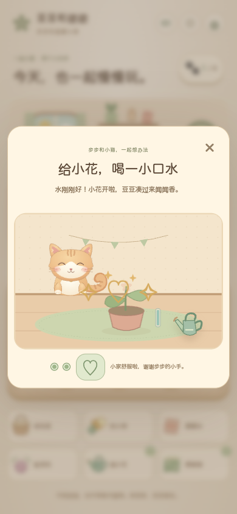

# 豆豆和团团 · 步步的温暖小家

一个面向4–6岁孩子的触摸宠物小世界。用拖动、抚摸、擦拭和物品图案来照顾猫咪，不依赖识字。

## 打开体验

**[打开在线小家](https://yeshaojun.github.io/doudou/)** · [下载单文件](https://github.com/yeshaojun/doudou/raw/refs/heads/main/index.html)


打开仓库根目录的 **index.html** 即可使用。图画、脚本、猫咪音效（M4A及WAV备用）都内嵌在同一个HTML中，不需要下载其他素材，也不调用大模型。

手机和平板建议通过 GitHub Pages 的 HTTPS 地址，在 Safari 中打开。首次点击“听听豆豆”启用声音；喇叭带斜线表示静音，可以再次点击开启。设备本身的音量也需要打开。

页面禁止双指缩放、双击放大和触控板快捷缩放，保留上下滚动，方便拖动操作。

## 可以玩什么

- 摸头、挠肚皮、击掌、眨眼、摇尾巴，眼睛跟随手指。
- 拖毛线球、挥羽毛，两只猫追逐玩耍。
- 喂饭、盖被睡觉、擦爪、叠被和纸箱躲猫猫。
- 刷牙小浴室：分区刷牙，再点杯子漱口。
- 六种生活故事：按图案收玩具、柜底寻球、扶杯擦水、轮流玩球、浇花、晾晒被子。
- 团团随机来访、花园串门、晴雨风天气和夜晚。
- 有前因的小事件邀请，孩子点开才进入；可以忽略或随时离开。

没有死亡、生病惩罚、每日签到和离线饥饿。进度保存在当前浏览器，不跨设备同步；家长设置可以导出和导入JSON存档。

## 文件与素材

| 位置 | 内容 |
| --- | --- |
| `index.html` | 可直接使用、可部署到GitHub Pages的完整单文件 |
| `standalone/` | 小家、刷牙、六种故事的源码和SVG插画 |
| `web/sounds/` | 原创电子合成的猫咪音效，七种WAV和M4A |
| `web/` | 猫咪动画引擎、原语音聊天界面与音效控制 |
| `worker/`、`scripts/` | 可选的模型聊天后端、打包与本地工具 |
| `test/` | 养成、触摸状态、声音、存档和后端回归检查 |
| `docs/DEVELOPMENT.md` | 原型开发记录和可选语音服务说明 |

轻柔的水滴、擦拭、夹子和完成音由Web Audio本地生成，不需要在线语音服务。

## 画面预览



## 本地开发

需要Node.js 22或更新版本，无第三方依赖。

```sh
npm run build
npm test
npm run preview
```

`npm run preview` 在 `http://127.0.0.1:4173` 打开纯宠物版本，不需要密钥。修改 `standalone/` 后重新运行 `npm run build` 更新根目录HTML。

可选的语音聊天后端使用 `npm run dev`，须先复制 `.env.example` 为 `.dev.vars` 并填写本机配置。密钥、访问口令和聊天记忆均不属于静态网页，不会打包到HTML，也不会提交GitHub。GitHub Pages不运行模型聊天后端。

## 验证与设备说明

自动化覆盖离线打包、音频备用格式、照料状态、小游戏分步命中、存档、邀请避让、后台暂停和原聊天服务。截图验证覆盖手机与平板尺寸；实体iPad的系统音量和Safari手势还需在设备上体验。

当前 **83 项自动检查通过**，浇花和晒被子经独立美术指导复审，已无P1/P2问题。实际浏览器验证了首次声音开启、摸头音效、水滴/夹子音效、浇花与两只被角夹子的完整流程。
